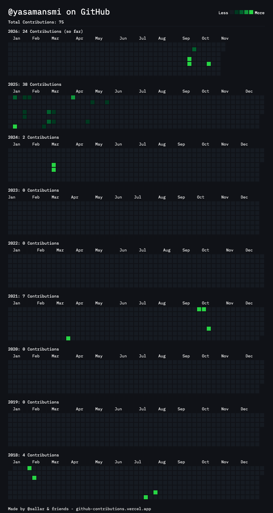

# Yasaman Samiee

I’m a Senior Data Scientist at **WorkWhile**, working on worker incentives, staffing forecasts, and experiments. Previously, I built authentication-risk and anomaly-detection models at SecureAuth and Acceptto.

[Portfolio](https://yasamansmi.github.io/) · [Résumé](https://yasamansmi.github.io/cv/) · [LinkedIn](https://www.linkedin.com/in/yasamansamiee/)

## Recent work

- Built a Bayesian reinforcement-learning system that updates worker incentives hourly across thousands of shifts. It improved fill rate while reducing spend per requested position by **17%**.
- Built understaffing forecasts with **20% lower validation MAE**, and an optimizer that recommended about **31% less backup staffing** in an offline comparison.
- Led randomized and switchback experiments on staffing and worker incentives, defining success metrics with business teams and evaluating service outcomes, costs, and profitability.
- At SecureAuth, built authentication-risk and anomaly-detection models with over **80% precision and recall**, and Bayesian risk models that reduced inference latency by **25%**.

My work includes the Python/SQL pipelines, online updates, monitoring, and testing needed to keep these systems running. At WorkWhile, I build AI agents that use customer conversations and operational data to understand accounts and workflows, suggest actions, and ask people for clarification when uncertain. I work with employees to adapt these tools to their needs and preferred platforms, and support adoption as workflows change.

At SecureAuth, I trained and deployed PyTorch autoencoders and variational autoencoders (VAEs) for anomaly detection.

**Tools:** Python, SQL, Dagster, BigQuery, GCS, Spark, scikit-learn, PyTorch, TensorFlow, Docker, and AWS.

## Personal projects

| Project | What it does |
| --- | --- |
| [CouchKarma](https://couchkarma.com) | Suggests something to watch, read, or listen to based on mood, taste, and available time, with Canadian streaming checks. Source is private. |
| [Peeky Data](https://github.com/yasamansmi/peeky-data) | A small Streamlit app for a first look at an unfamiliar CSV: missing values, duplicate rows, column types, and distributions. |

## Research

“Deploying Budget-Aware Model-Based Reinforcement Learning for Incentive Allocation in an Online Labor Marketplace” — submitted to IAAI-27 (part of AAAI-27), Deployed AI Applications Track, 2026. **Under review.**

Earlier publication: “An Analysis of the BWE-Associated Costs: The Issue of Demand Forecasting Accuracy,” *IFAC PapersOnLine*, 2020.

## GitHub contributions

View my contribution history

Snapshot generated November 2, 2026 with [GitHub Contributions Chart Generator](https://github-contributions.vercel.app/).

